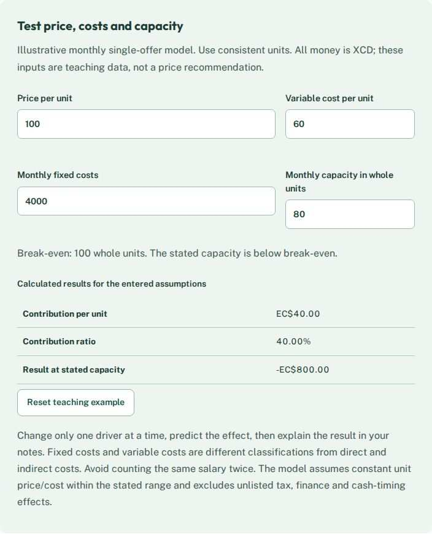
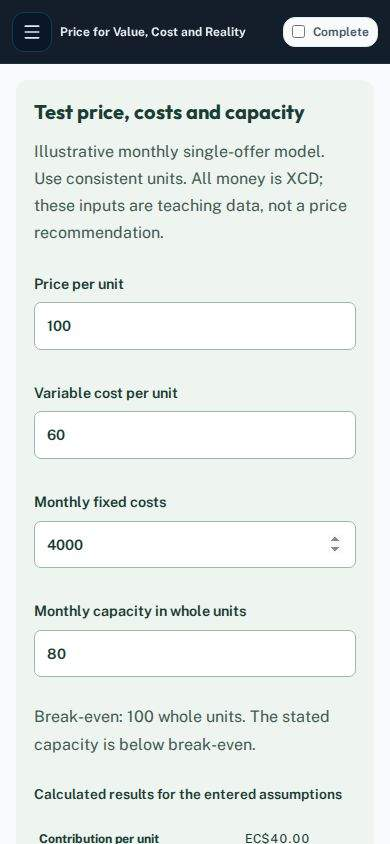
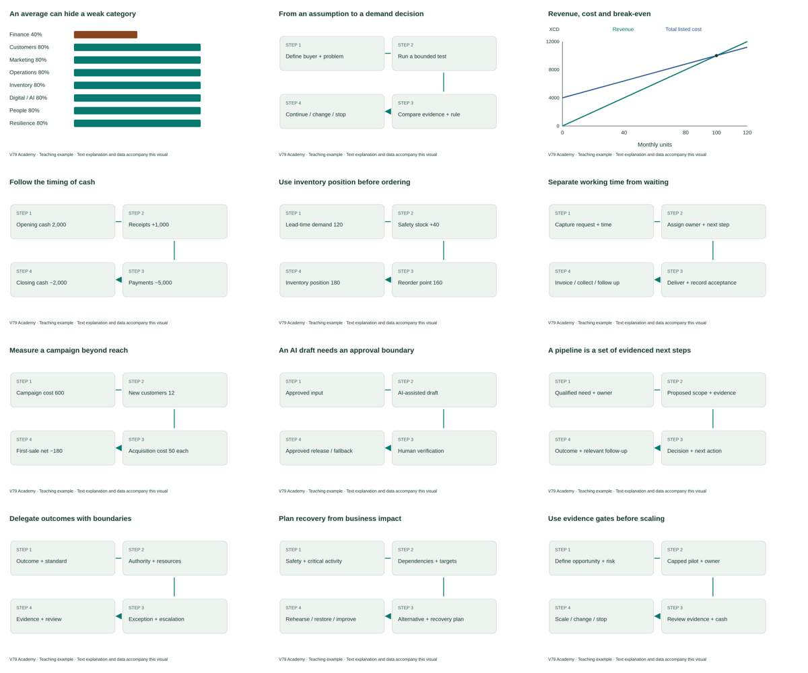

# Business self-study release — 15 November 2026

Deployed at approximately 10:54 Saint Lucia time. [PR #42](https://github.com/MrFixITslu/V79acaedmy/pull/42) merged after all three GitHub workflows passed. This follow-up records evidence and recovery tools; it does not replace the deployed application image.

| Item | Observed result |
| --- | --- |
| Checked application source | `a19f43ebd2ca492df4773632fa974f2d0f6f8f33` |
| Image | `sha256:159b797844dce933a7c644748e046c85021245cfd18ae57af3a8f2a9f8ce549c` |
| Business course | 2.1.0; 36 lessons, 12 modules; original assessments retained |
| Catalogue | Six courses, three advertised for independent study |
| Migration | 36 exact original teaching fingerprints matched; complete original content snapshot preserved |
| Data preservation | Full store matched the specified change; learner-file bytes unchanged at startup |
| API | Existing account/access tests, AI/networking journeys and complete business assessment/certificate journey passed in the built image with synthetic users |
| Browser | Notes/bookmarks persisted after reload; explained checks, calculator boundaries/reset and keyboard input order passed |
| Restored staging browser | Exact built image; 320, 390, 768, 1024 and 1440 CSS px; no horizontal page overflow or page errors; reduced motion checked |
| Calculator | 500 independent Python Decimal comparisons and boundary tests passed |
| Images | Twelve SVGs parsed and rendered; contact sheet inspected; all twelve served publicly |
| Recovery checkpoint | Encrypted archive decrypted off-host; five JSON files parsed; SHA-256 `e636f0d690426aa6882cc590e183a1f95dbb371b4b09c024dc3fa51986dbe3f2` |
| Public smoke | Five HTTPS HTML/asset/catalogue checks passed; private source/data denied; workbook and insights access enforced |
| Hub | Signed course read passed inside deployed container; no identity configuration changed |
| Operation | Restart policy `always`; proxy configuration tested/reloaded; staging stopped |

These are self-run checks, not independent accreditation, a comprehensive accessibility audit, field performance measurements or tests on physical phones. Existing MFA/SSO settings were preserved; no new real-user SSO sign-in is claimed.

## Screenshots

Synthetic browser fixtures, not learner/customer data. Desktop, mobile and the diagram contact sheet were visually inspected.

## Recovery procedure and compatibility

The retained old container is `v79-academy-pre-business-20261115`, stopped with restart disabled. Its image is `sha256:945973beff360badca824d9aea0385af6a22301b7f3ba1bee234a135426cf36e`. Never start it alongside the live writer.

An old-image health check alone is insufficient: that image does not contain the twelve new SVG files or the new calculator component. A compatible rollback must restore the prior business teaching fields and course metadata as well as the image. Preserve all current learner files, notes, progress, certificates and history. Do not restore an entire old data directory over later learner activity.

1. Capture a fresh private recovery checkpoint, then stop the canonical application and confirm no other container writes to its mount.
2. Make an offline copy of the current data. Prepare a separate compatible content store with `python3 scripts/prepare-business-content-rollback.py OFFLINE_STORE docs/curriculum-audit/business-expected.json NEW_OUTPUT_FILE`. It refuses changed lesson membership or post-release teaching/course edits; reconcile such changes manually. It never writes learner files or overwrites its input.
3. Compare the output with the saved original course snapshot and current unrelated records. Record current learner-file hashes. Install only the prepared `store.json` atomically, retaining file ownership and permissions, while the application remains stopped. Keep both the prior live store and the checkpoint.
4. Run the guarded `scripts/release-business.py rollback` from the release checkout after bringing that recovery script/helper up to this follow-up revision. It refuses an old-image rollback while incompatible diagram/calculator references remain. Validate health, original business asset paths, catalogue and protected routes, reload the tested proxy and recheck the public site. Confirm learner hashes remain unchanged before accepting traffic.
5. Keep migration/version history. A later roll-forward requires a reconciled migration; do not erase audit markers to force replay.

The compatible-content rehearsal passed on a private restored copy: the previous immutable image served the original 36 lessons and their original local image path, and learner bytes remained unchanged. The operator guard refused incompatible content before any Docker mutation; it allowed a compatible synthetic restoration. Neither rehearsal changed production. See private receipts for full command evidence; no credentials or learner data are included here.

## Outstanding

144 legacy lessons still need full content/lab or junior-programme verification. Junior courses retain supervision/team requirements. Fabric/KQL/Spark environment checks are not claimed. Monthly US$35/EC$94 collection remains blocked by unverified live merchant currency and recurring-payment support; current evidence is sandbox TT/TTD. No live charge or billing configuration was changed.
